# Netflix Content Analysis

### Internship Project – CognoRise InfoTech

## Project Overview

This project focuses on analysing Netflix Movies and TV Shows data to understand the distribution of content, popular genres, country-wise contributions, release trends and content duration.

The analysis is performed using Python libraries for data cleaning, exploratory data analysis, statistical testing and visualization.

## Objectives

- Analyse the distribution of Movies and TV Shows.
- Identify countries contributing the most titles.
- Explore the most common genres on Netflix.
- Examine content release trends over time.
- Analyse movie durations and TV Show seasons.
- Perform statistical tests to identify relationships and differences in the dataset.

## Technologies Used

- Python
- Pandas
- NumPy
- Matplotlib
- Seaborn
- SciPy
- Jupyter Notebook
- VS Code

## Dataset

**Dataset:** Netflix Movies and TV Shows

**File name:** `netflix_titles.csv`

The dataset contains information about Netflix titles, including:
- Show ID
- Title
- Director
- Cast
- Country
- Release Year
- Rating
- Duration
- Genre
- Date Added

## Project Workflow

### 1. Data Loading and Inspection
Loaded the dataset using Pandas and examined its structure, columns, missing values and duplicate records.

### 2. Data Cleaning
- Removed duplicate records.
- Handled missing values.
- Corrected misplaced duration values.
- Converted date columns.
- Extracted movie duration and TV Show seasons.
- Prepared country, genre and director data for analysis.

### 3. Exploratory Data Analysis (EDA)

The analysis includes:

- Movies vs TV Shows distribution.
- Release year trends.
- Netflix content additions by year and month.
- Top 10 countries.
- Content ratings and audience categories.
- Top 12 genres.
- Director analysis.
- Movie duration and TV Show seasons.

## 📈 Statistical Analysis

Three statistical tests were performed to examine relationships and differences in the Netflix dataset.

### 1. Chi-Square Test (Content Type vs Audience Category)

- **Chi-square statistic:** 69.78
- **Degrees of freedom:** 3
- **P-value:** 4.764 × 10⁻¹⁵

**Interpretation:**

The test showed a statistically significant association between content type (Movies and TV Shows) and audience category at the 5% significance level.

This indicates that audience categories are distributed differently across Movies and TV Shows.

### 2. Spearman Rank Correlation (Release Year vs Movie Duration)

- **Spearman correlation (rho):** -0.191
- **P-value:** 1.754 × 10⁻⁵¹

**Interpretation:**

A weak negative correlation was observed between movie release year and duration.

This suggests that newer movies tend to have slightly shorter durations than older movies.

### 3. Mann-Whitney U Test (Recent vs Older Movie Durations)

- **U statistic:** 3,218,494
- **P-value:** 7.365 × 10⁻⁵⁵
- **Median duration of recent movies (2015+):** 96 minutes
- **Median duration of older movies:** 104 minutes

**Interpretation:**

The test identified a statistically significant difference in movie durations between recent and older movies.

Recent movies have a median duration of 96 minutes, compared to 104 minutes for older movies.

### Statistical Analysis Summary

All three statistical tests produced p-values below 0.05, indicating statistically significant findings in the analysed dataset.

### 5. Dashboard

Created a dashboard containing four visualizations:
- Movies vs TV Shows.
- Titles by release year.
- Top 10 countries.
- Top 12 genres.

### Netflix Content Analysis Dashboard

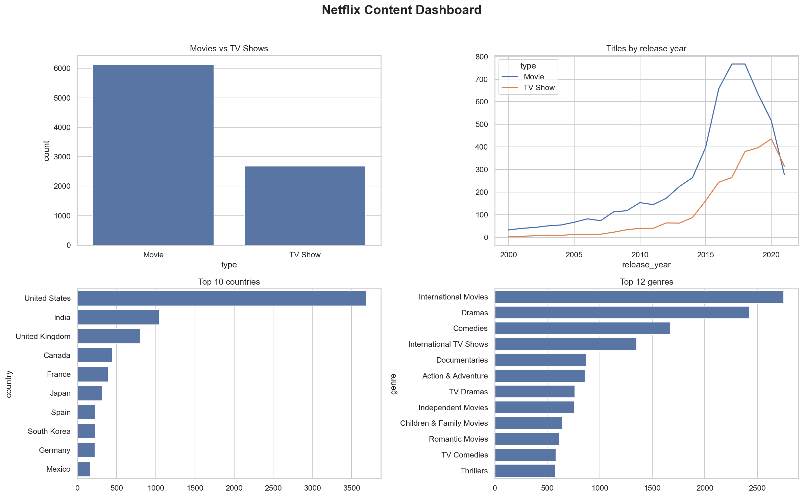

## 📊 Data Visualizations

### 1. Movies vs TV Shows Distribution
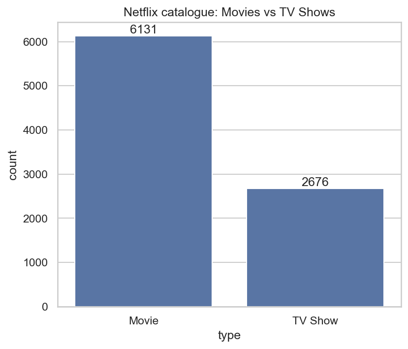

### 2. Release Year Trend
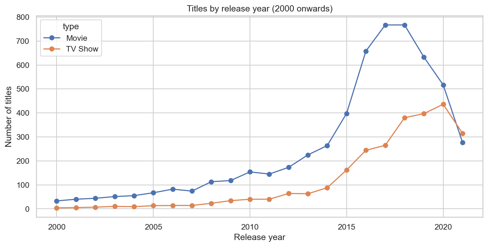

### 3. Content Added Per Year
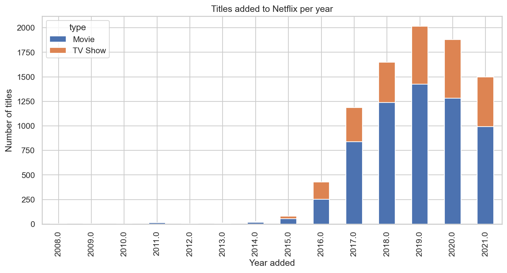

### 4. Content Added by Month
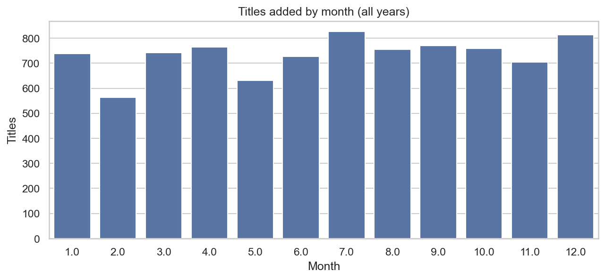

### 5. Top 10 Countries
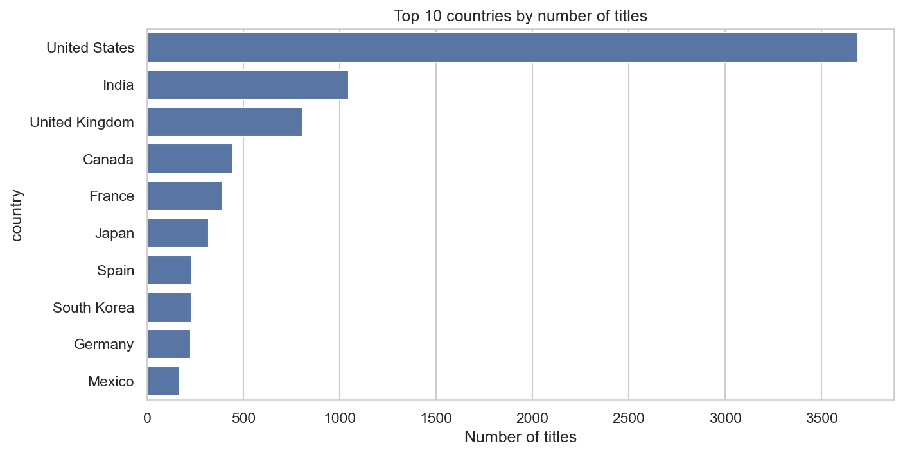

### 6. Content Ratings and Audience
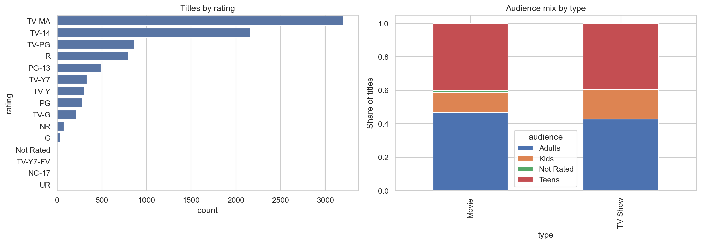

### 7. Top Genres
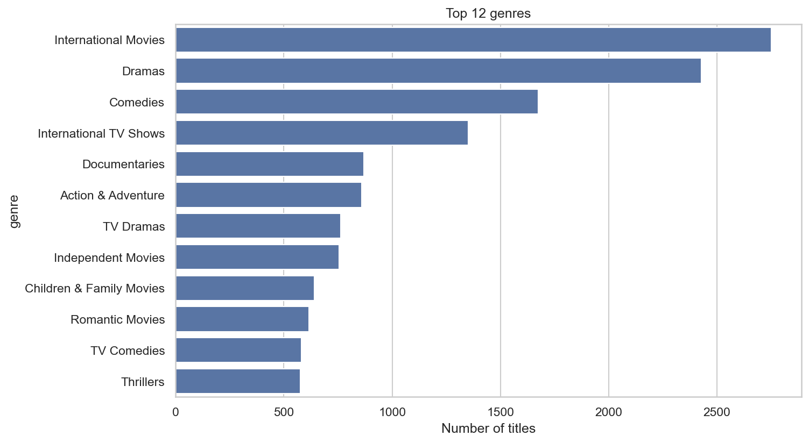

### 8. Genre Trends
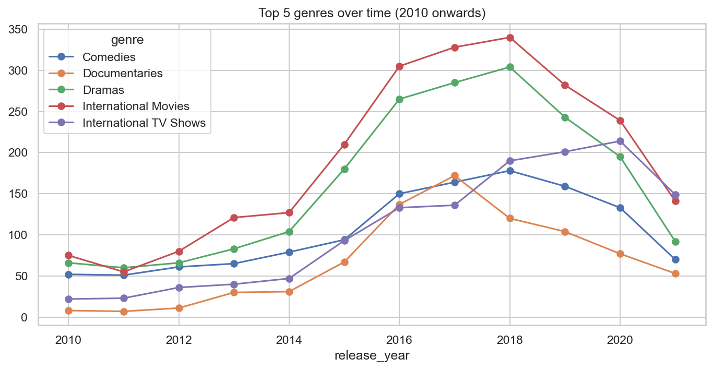

### 9. Top Directors
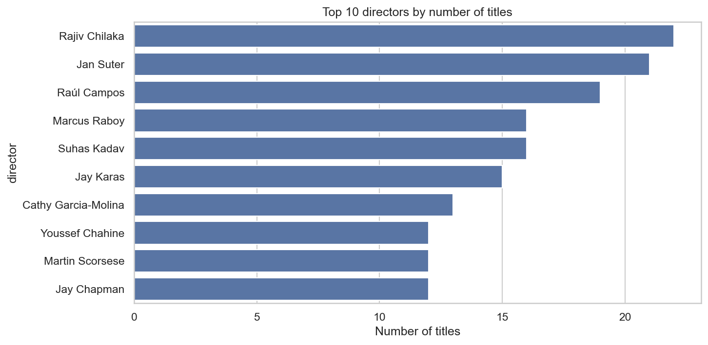

### 10. Movie Duration Analysis
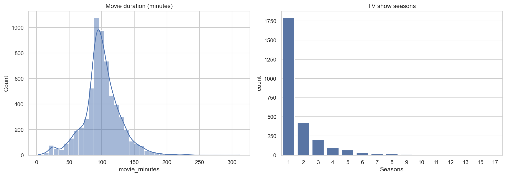

## 🔍 Key Findings

### 1. Content Distribution
- Total titles analysed: 8,807.
- Movies account for 69.6% (6,131 titles) of the catalogue.
- TV Shows represent 30.4% (2,676 titles).
- Movies make up the majority of Netflix's content library.

### 2. Country-wise Distribution
- The United States contributes the highest number of titles.
- India ranks second, followed by the United Kingdom.
- This highlights the significant contribution of these countries to Netflix's content library.

### 3. Genre Analysis
- International Movies are the most frequently listed genre.
- Dramas and Comedies are also among the most common genres.
- International Movies and Dramas reached their highest counts around 2018, followed by a decline in subsequent years.

### 4. Content Duration
- Average movie duration: 99.6 minutes.
- Median movie duration: 98 minutes.
- Average TV Show seasons: 1.8.
- Median TV Show seasons: 1 season.
- Most TV Shows in the dataset have only one season.

### 5. Statistical Insights
- Chi-square testing identified a significant association between content type and audience category.
- Spearman correlation showed a weak negative relationship between movie release year and duration.
- Mann-Whitney U testing identified a significant difference between recent and older movie durations.
- Recent movies have a median duration of 96 minutes, compared with 104 minutes for older movies.

## ⚠️ Project Limitations

Although the analysis provides useful insights into Netflix's content catalogue, some limitations should be considered:

1. **Missing Data:** Several records contain missing information, particularly in the Director, Cast and Country columns. Missing values were handled using appropriate placeholders such as "Unknown".

2. **Dataset Snapshot:** The dataset represents a snapshot of Netflix's catalogue and does not reflect real-time content additions or removals.

3. **Limited Business Information:** The dataset does not contain viewer counts, streaming hours, revenue or audience engagement metrics.

4. **Multi-Category Records:** Some titles are associated with multiple countries and genres. Consequently, category-wise counts may include the same title more than once.

5. **Incomplete Metadata:** Some titles have missing ratings, durations or date-added information, which may affect specific analyses.

6. **Descriptive Analysis:** The findings describe patterns and statistical associations in the dataset; they do not establish causal relationships.

## 🚀 How to Run the Project

Follow these steps to run the Netflix Content Analysis project on your local machine.

### 1. Clone the Repository

```bash
git clone YOUR_GITHUB_REPOSITORY_URL
```

### 2. Navigate to the Project Folder

```bash
cd netflix-content-analysis
```

### 3. Install Required Libraries

```bash
pip install numpy pandas matplotlib seaborn scipy jupyter
```

### 4. Check Dataset

Ensure that `netflix_titles.csv` is available in the project directory.

### 5. Open the Jupyter Notebook

```bash
jupyter notebook
```

Alternatively, open `netflix_content_analysis.ipynb` directly using Visual Studio Code.

### 6. Execute the Notebook

Run all cells sequentially to perform:

- Data loading and inspection.
- Data cleaning and preprocessing.
- Exploratory Data Analysis.
- Statistical hypothesis testing.
- Data visualization and dashboard generation.

The analysis outputs are stored in the `outputs` folder.

## Author

**Muhsina Rinsha T P**

B.Tech – Artificial Intelligence and Data Science

Internship: CognoRise InfoTech
